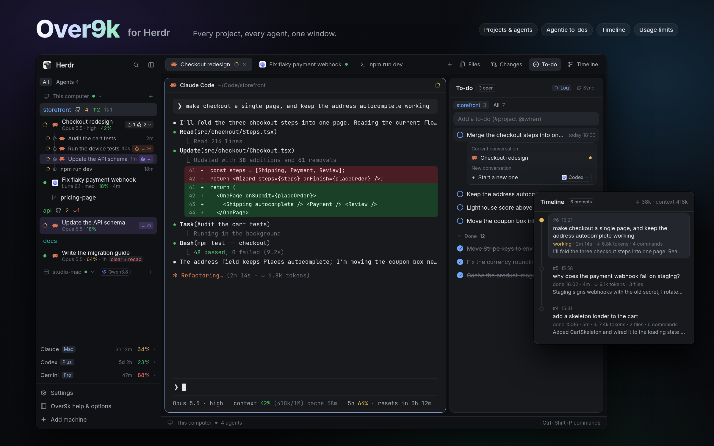

# Over9k for Herdr

**Run a fleet of coding agents and actually know what they're doing.** Over9k is
a [Herdr](https://herdr.dev) layout that takes your productivity and visibility
over 9000.

- **See everything.** Every project and every agent in one sidebar: who's
  working, who needs you, which model, how full the context is, the subagents
  and background jobs they started, and where their work is going.
- **Projects that set themselves up.** Point it at your code folder and every
  repo shows up with its git state. Pin the ones you care about, park the rest.
- **Save tokens.** When an agent's cache has expired, one click clears it and
  restarts it from a short recap, instead of re-reading the whole chat.
- **Agentic to-dos.** Agents add what you ask for as you ask it and tick it off
  when it's done, in sync with your TODO.md. Send any to-do to an agent in one
  click.
- **Chats that become projects.** Start a chat anywhere. When it turns into
  project work, it hands off to a new agent in that project's space, with a
  brief.
- **Pick up where you left off.** Resume any past Claude Code, Codex or Pi
  session from one menu.
- **Local models in a click.** Start Pi on Qwen or any local model. Its server
  starts for you and stops from the same menu.
- **The Timeline.** Every prompt, with how long it took and the tokens it cost,
  live while the agent works.
- **Your limits in view.** Claude, Codex and Gemini usage, before you hit the
  wall.
- **Make it yours.** Menus and Options decide what every row shows.

Use the whole layout, or add any of its six mods to your own.



## What you get

- **Sidebar.** A space for each project in your projects folder, pinned or
  parked. Each shows its branch, uncommitted files, pull requests and
  push/pull. Under each project are its agents, with their status, model,
  context and time since their last reply. Under each agent are its subagents,
  background commands and scheduled prompts. Links show where agents are going:
  one working in another space, or on another computer over SSH, is marked at
  both ends. Open folder opens any project, and you can pick several rows to
  act on together. When an agent's prompt cache has expired, a red "exp."
  becomes a token-saving "clear + recap": it restarts the agent from a short
  summary instead of having it re-read the whole chat. The + menu resumes past
  chats and starts Pi on local models like Qwen.
- **To-do and Timeline in Herdr's tab bar.** Two buttons beside Herdr's own
  Files and Changes. Ctrl+Tab switches between agents, most recent first.
  Closing a tab or pane asks first, and says what's still running.
- **To-do panel.** Agentic to-do lists, one per project, with tabs for the
  project you're in and for All your pinned projects.
  - **Log:** agents add what you ask for as you ask it, and tick it off when
    it's done, with the `todo` command.
  - **Sync:** the list stays in step with the project's own TODO.md.
  - **Send:** any to-do goes to the current conversation or to a new agent.
  - **Several at once:** mark done, send or delete them together.
- **Timeline panel.** Your prompts in the agent you're in, each with how long
  the agent worked, when it finished, the tokens it wrote, and the files and
  commands it touched. Click a prompt to read the whole reply. The header shows
  the tokens the agent has written and the context it holds now.
- **Usage.** The 5-hour and weekly limits of Claude, Codex and Gemini, above
  Settings.
- **Help & options** at the bottom of the sidebar. Help is illustrated. Options
  covers what each row shows, the panels, and the Claude Code extras.

## Mods on their own

Each folder below is one mod you can add to your own Herdr layout, without the
rest of Over9k. Each has its own `RECIPE.md` and `preview.png`.

| Folder | What it is | Where it goes |
|---|---|---|
| [`over9k-sidebar`](over9k-sidebar) | Projects and agents, with git, subagents, links, the expired-cache recap, hand-off, and its own Help & Options | Docks on the left |
| [`over9k-launcher`](over9k-launcher) | Start agents and CLIs, resume sessions, Pi on local models, stop a model's server | Ctrl+Shift+A |
| [`over9k-todo`](over9k-todo) | The agentic to-do panel and the `todo` command | Docks on the right |
| [`over9k-timeline`](over9k-timeline) | The conversation's prompts, with time and tokens | Docks on the right |
| [`over9k-usage`](over9k-usage) | Claude, Codex and Gemini limits in one line | Docks at the bottom |
| [`over9k-switcher`](over9k-switcher) | Ctrl+Tab between agents, most recent first | Ctrl+Tab |

To add one:

```sh
sh install.sh over9k-todo            # or: install.ps1 -Mod over9k-todo
sh install.sh over9k-todo --uninstall
```

The mod docks itself the first time Herdr sees it. The Over9k layout already
includes all six, so install either the layout or individual mods, not both.

## Requirements

| | |
|---|---|
| [Herdr](https://herdr.dev/download/) | 0.1.12 or newer |
| git | the sidebar's branch, changes and push/pull |
| jq | Claude Code's status line, subagents, background tasks, resume, hand-off |
| Python 3 | the Timeline, TODO.md sync |
| Agents | Claude Code gets the most (status, Timeline, to-dos); Codex, Pi and Antigravity are listed too |

Over9k still works without git, jq or Python; it just leaves out the features
that need them. The installer says what's missing and how to install it.

**Platforms.** Over9k is developed on Linux. The macOS and Windows code paths
are in place, but neither has been run there yet. Please report what doesn't
work.

- **Linux:** everything.
- **macOS:** everything except two extras that read Linux's `/proc`: finding
  Codex sessions, and listing Antigravity's subagents. Install the tools with
  `brew install jq python git`.
- **Windows:** needs [Git for Windows](https://git-scm.com/download/win), whose
  `sh` runs Over9k's scripts, plus jq and Python:
  `winget install Git.Git jqlang.jq Python.Python.3.12`. The installer can put
  Git's tools on your PATH (`-AddGitToPath`). The same `/proc` extras as on
  macOS are left out.

## Install

```sh
git clone https://github.com/herunan/herdr-over9k.git
cd herdr-over9k
sh install.sh                # Linux, macOS, or Git Bash on Windows
```

Or download the ZIP from GitHub, unzip it, and run the installer from inside it.

On Windows, from PowerShell:

```powershell
powershell -ExecutionPolicy Bypass -File install.ps1
```

Then open Herdr and pick **Settings › Layout › Over9k**. If Herdr is already
running, `herdr-app do layout.switch '{"name":"over9k"}'` switches to it.
**Over9k help & options**, at the bottom of the sidebar, walks you through
picking your projects folder.

The installer takes these options:

- `--home <dir>` (`-HerdrHome` on Windows): a different Herdr home.
- `--no-claude` (`-NoClaude`): leave Claude Code's settings alone.
- `--yes` (`-Yes`): don't ask any questions.

To update, get a newer copy and run the installer again. Your settings and lists
stay.

### What the installer changes

- **Herdr's home** (`~/.config/herdr-app`, or wherever `herdr-app --help` says):
  the mods in `mods/over9k*`, the layout in `layouts/over9k.json`, and Over9k's
  key bindings merged into `keys.json`. Your earlier `keys.json` is kept as
  `keys.json.before-over9k`, and any bindings Over9k replaces come back when you
  uninstall.
- **Claude Code**, only if you say yes: its status line (your own is kept aside),
  the to-do rule in `~/.claude/CLAUDE.md`, the `todo` command in
  `~/.local/bin`, and a hook that reminds agents when request logging is on.
  Codex's and Pi's `AGENTS.md` get the same to-do rule. You can turn each of
  these off again in Options.

## Optional extras

Each of these is off until you turn it on, and each says what it changes.

- **Claude Code status line** (Options › Claude Code). This is the line under
  Claude Code's prompt: model, context, cache and limits. It's also where the
  sidebar's agent details, the usage rows and the Timeline get their data, so
  keep it on unless you have your own. Yours is kept aside and comes back when
  you turn it off.
- **To-do for agents** (Options › To-do, on by default when installed). This
  sets up the rule, the `todo` command and the hook. Below it you can choose
  whether new projects start with Log and Sync on.
- **Hand off project work** (Options › Folders). A chat started outside your
  projects can hand project work to a new agent in that project. This adds a
  rule to CLAUDE.md and AGENTS.md.
- **Antigravity (Gemini) usage and titles.** These are set up by hand. Add the
  following to `~/.gemini/antigravity-cli/settings.json`, with `<mods>` replaced
  by your Herdr home's `mods` folder:

  ```json
  "statusLine": { "type": "command", "command": "sh <mods>/over9k/antigravity/agy-statusline.sh", "stack_with_default": true },
  "title": { "type": "command", "command": "sh <mods>/over9k/antigravity/agy-title.sh" }
  ```

  The usage rows then show Gemini's limits, and the sidebar names Antigravity
  agents by their conversation. Conversation titles need `sqlite3`.
- **Local models for Pi.** The + menu's **Model ›** button for Pi lists the
  models in Pi's `~/.pi/agent/models.json`, and starts a local model's server
  when it has one.

## Uninstall

```sh
sh install.sh --uninstall          # or: install.ps1 -Uninstall
```

This removes the mods, the layout, Over9k's key bindings (giving yours back) and
its Claude Code pieces, restoring your own status line. Your to-do lists stay in
`~/.local/share/over9k`; delete that folder to remove them too.

## Privacy

Over9k has no server of its own and collects nothing. It reads your agents'
conversation files, your git repos and Herdr's state on your computer. It
reaches the network in three ways, all through your own tools:

- **git:** every 5 minutes it fetches each project that has a GitHub remote,
  to show how far ahead or behind it is. Push and pull happen only when you
  click them.
- **GitHub (`gh`), if installed:** in the same 5-minute pass it counts each
  repo's open pull requests and checks whether your review is wanted.
- **Local model servers:** the + menu checks whether the servers in Pi's
  `models.json` are up, at the addresses listed there.

Other computers you've added to Herdr are reached through Herdr itself.

## In this repo

```
install.sh, install.ps1   install, update, uninstall (the layout, or one mod)
tools/build-mods.py       builds the mod folders below from over9k/mods
over9k-sidebar/ … over9k-switcher/   the six mods on their own, each with
                          mods/, RECIPE.md, preview.png (and keys.json)
over9k/                   the Over9k layout, as Herdr shares layouts:
  RECIPE.md, preview.png  the brief to build it from, and its picture
  keys.json               Over9k's key bindings
  layouts/                the layout and its preview
  mods/
    over9k/               the sidebar (+ statusline.sh, antigravity/)
    over9k-tabs/          Herdr's tab bar, with To-do and Timeline added
    over9k-todos/         the To-do panel, todo.sh (the `todo` command), its hook
    over9k-prompts/       the Timeline panel
    over9k-usage/         the usage rows
    over9k-options/       Help & Options, setup.sh (what the switches set up)
    over9k-menu/          right-click menus
    over9k-new-menu/      the + menu (start agents, resume chats, other models)
    over9k-footer/        the sidebar's footer
    over9k-switcher/      Ctrl+Tab between agents
    over9k-close/         asks before closing what's still running
    over9k-handoff/       hand an agent's work to another space
    over9k-rename/        rename dialogs
    over9k-server-stop/   stop a local model's server
    over9k-panel/         the header over a subagent shown in the side panel
```

## Licence

MIT. See [LICENSE](LICENSE).
