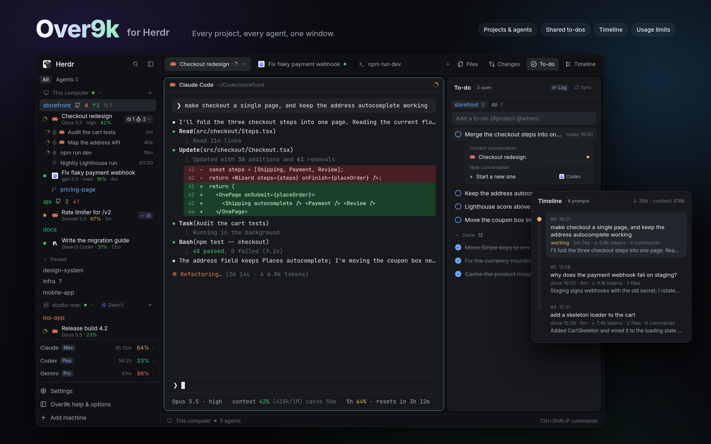

# Over9k

A dark, dense Herdr window for working with many coding agents at once. On the
left, a sidebar lists every project as a space, with its git state, and under
each project the agents working in it: their status, model and context, plus
the subagents, background commands and scheduled prompts each one started.
Usage limits for Claude, Codex and Gemini sit above the footer. Across the top,
a tab bar holds the space's tabs and four panel buttons: Files, Changes, To-do
and Timeline. The middle shows the active tab's panes as rounded cards. On the
right, an optional panel shows a per-project to-do list shared with agents, or
a timeline of the conversation you're in.

## What you see

Left to right. All colours are theme names (`canvas`, `chrome`, `background`,
`raised`, `hover`, `selected`, `border`, `foreground`, `muted`, `dim`, `accent`,
`working`, `blocked`, `done`, `ansi1`–`ansi3`), so it follows any theme.

- **Sidebar**, 268px wide (44 to 480), on `chrome`. From top to bottom:
  - **Brand**, 46px: Herdr's own `workspace-chrome`. Drags the window.
  - **Spaces**, filling the rest of the height (`over9k`):
    - A filter row, 30px high: **All** and **Agents N** as 20px text tabs, the
      picked one on `raised`.
    - Each computer's header: "This computer", or a machine's name, with a
      monitor or server icon, a green connection dot, a fold chevron and a +.
    - Each project as a 30px row, its name in its own colour, then up to four
      badges: a GitHub mark, the uncommitted count (`ansi3`), ↑ ahead
      (`ansi2`) and ↓ behind (`ansi1`), and open pull requests (a PR icon and
      a count, red when your review is wanted).
    - The open space is on `selected`, and worktrees sit under their checkout
      with a branch icon.
    - Under each project, its agents. Each has a status mark, the program's
      logo, the conversation's name, and below it in 11px `dim`: model · effort
      · context % · time since the last reply. Context is green under 50%,
      yellow from 50% and red from 80%.
    - Under each agent, a tree drawn with a 1.5px rail: subagents, background
      commands and scheduled prompts. Each has its icon, its name in `muted`,
      and its age or time.
    - Projects not open are listed under a folded **Parked** heading (11px,
      `dim`).
  - **Usage** (`over9k-usage`): one 29px row per service, as tall as its rows.
    Each row has the name in `muted`, the plan in a 10.5px badge (`raised`
    background, `accent` text), the reset time in `dim`, the used percentage
    coloured green, yellow or red, and a chevron.
  - **Footer**, 97px (`over9k-footer`): Settings, Over9k help & options, and
    Add machine, each 30px with a 14px icon.
- **Work column**, filling the rest:
  - **Tabs**, 42px (`over9k-tabs`): the space's tabs as pills, each with its
    program's icon, status and a close ×, then a +. On the right are the panel
    buttons (Files, Changes, To-do, Timeline), each a 14px icon and label, the
    open one on `selected`. Drags the window.
  - **Body**, 8px padding and gap:
    - **The active tab's panes:** cards with a 10px radius, a 1px `border` (or
      1px `accent` for the focused one) and Herdr's `pane` header, 30px, always
      shown.
    - **The side panel**, 368px (280 to 900), hidden until a panel button opens
      it. It's a stack of Files, Changes, To-do (`over9k-todos`) and Timeline
      (`over9k-prompts`).
  - **Status bar**, 28px: Herdr's `workspace-status`.

**To-do panel:**
- A 42px header: "To-do", an outlined "N open" badge, then the **Log** and
  **Sync** tags for the project you're in. A tag is on `raised` with `accent`
  text when on, and plain `dim` when off.
- Two text tabs: the project you're in (its name in its colour, with a count)
  and **All** (pinned projects).
- A shaded add box, "Add a to-do (#project @when)".
- 30px rows: a 14px circle in the project's colour, the text on one line, then
  the due time or done time in 11px, and in All the project's name, flush right.
- A foldable **Done** section with Clear on the right, then "From TODO.md"
  suggestions.

**Timeline panel:**
- A 42px header: "Timeline", an "N prompts" badge, then the agent's name and
  "↓ 38k · context 418k".
- Prompts newest first on a vertical line, a 10px dot each (filled `working`
  for the turn in progress).
- Each prompt is a card: number and time, the prompt on one line, then "done
  16:02 · 4m · ↓ 9.1k tokens · 3 files · 6 commands", then the reply's first
  sentence in `muted`.

## How it behaves

- **Agent status** (sidebar, tabs, Timeline):
  - **working:** a 12px spinner in `working`.
  - **blocked:** a 7px dot in `blocked`. The Agents view puts these under "Needs
    you".
  - **done:** a dot in `done`. It turns idle once someone has looked.
  - **idle:** no mark, and the name in `muted`.
- **Clicks in the sidebar:**
  - A project or agent focuses it. Double-click renames.
  - Right-click opens `over9k-menu`: pin, unpin, rename, Open folder, project
    icons, Hand off…, splits, close.
  - Shift-click picks a range and Ctrl or Cmd-click picks one more. Right-click
    a picked row to act on all of them.
  - On a project's badges: the GitHub mark opens the repo, the count opens
    Changes, ↑ pushes (click twice), ↓ pulls.
  - The + on a computer opens `over9k-new-menu`: start a CLI or an agent, resume
    a past chat, or start Pi on another model.
  - Clicking an agent's chip shows or hides what it started. Clicking a
    subagent opens it, Alt-click opens it in the side panel under an
    `over9k-panel` header, and × stops it.
- **Expired cache:** when an agent's prompt cache has run out, its details end
  in a red "exp.", and a "clear + recap" chip restarts it from a short summary.
- **Keys:**
  - Ctrl+Tab opens `over9k-switcher`: agents, most recent first. Holding Ctrl,
    Tab and Shift+Tab move, and letting go of Ctrl opens the picked agent.
  - Ctrl+Shift+W and Ctrl+Shift+X close the tab or pane, asking first through
    `over9k-close`, which says what ends.
- **Panel buttons** toggle the side panel. Timeline opens only from its own
  button: if anything else turns the panel to it, the tab bar puts the previous
  panel back.
- **To-do:**
  - Click the circle to tick. Double-click to edit.
  - The bot button (on hover) opens a card. **Current conversation** sends the
    to-do to an agent already in that project. **New conversation** starts a
    new one of the kind picked.
  - `@fri 3pm` and `#api` in the add box set a due time and a project.
  - On the project tab, Ctrl or Shift-click picks rows. A bar then shows "N
    selected" and Cancel, above Mark done, Send to agent and Delete (click
    twice).
- **Timeline:**
  - Click a card to read the whole prompt and the reply, rendered as Markdown.
  - While the agent works, its time and ↓ tokens are read from the CLI's own
    screen every 2s, so they match the CLI exactly.
- **Usage:** click a row to show every limit as a 3px bar, with its reset time.
  The block resizes to fit.

## Built from

- **Layout `layouts/over9k.json`**, cloned from `main`. The root `row` has
  `titlebar: none`, `terminal_menu: "over9k-menu"`, a 1px `border` divider and
  `preview: layouts/over9k.svg`.
  - `sidebar` column: `brand` (workspace-chrome), `sidebar-lists` holding
    `spaces` (over9k), `usage` (over9k-usage), and `sidebar-footer`
    (over9k-footer, `props.footer: true`).
  - `work` column: `tabs` (over9k-tabs), `work-body` row, and `status`
    (workspace-status).
  - `work-body` row: `main` (`tab: active`, with a pane header from `pane`)
    and `panel`, a column holding the `panel-body` stack: files, changes,
    todos, prompts.
- **Mods**, all `"place": "none"`:
  - `over9k`: the sidebar. It also writes shared state the others read:
    `over9k.recentAgents`, `projects.pinned`, `projects.listed`.
  - `over9k-usage`, `over9k-footer`, `over9k-tabs`.
  - `over9k-todos` (with `todo.sh`, `todo-cross.py`, `todo-hook.sh`) and
    `over9k-prompts` (with `prompts.py`).
  - Overlays: `over9k-menu`, `over9k-new-menu` (with `resume.sh`),
    `over9k-switcher`, `over9k-close`, `over9k-rename`, `over9k-handoff`,
    `over9k-server-stop`, `over9k-panel`.
  - `over9k-options`: the Help and Options overlay. Its `setup.sh` turns the
    pieces outside Herdr on and off.
- **Shipped mods used:** `workspace-chrome`, `workspace-status`, `pane`,
  `files`, `changes`, `picker`, `machine-add`, `worktree`, `new-menu`, plus
  Herdr's `icons/` for agent logos.
- **herdr API:**
  - Reading state: `spaces`, `agents`, `terminals`, `panes`, `focused`,
    `layout`, `machines`, `knownAgents`, `themes`.
  - Commands through `run`: `layout.select` / `show` / `hide` / `resize` /
    `set`, `pane.focus`, `tab.new`, `space.new`, `agent.focus`, `terminal.peek`.
  - The rest: `openOverlay`, `closeOverlay`, `notify`, `shared` / `setShared`,
    `readTextFile`, `writeTextFile`, `watchFolder`, `nextCommand`, and `exec`
    and `hc` (`read`, `send`, `kill`, `run`).
- **Programs:**
  - `sh` runs the scripts. `git` reads status and fetches every 5 minutes.
  - `gh` counts open PRs, if installed. `jq` is used by the scripts.
  - Python 3 runs the Timeline reader and the TODO.md sync. `ps`, `curl` (local
    model servers) and `kill` are used too.
- **Outside Herdr**, turned on from Options:
  - `over9k/statusline.sh` as Claude Code's status line. It writes
    `~/.cache/claude-agents/<terminal>.json` (model, effort, context, cache,
    transcript) and `~/.cache/over9k/usage/claude.json`, which is what the
    sidebar, the usage rows and the Timeline read.
  - The `todo` command: a wrapper in `~/.local/bin` for `over9k-todos/todo.sh`.
    It keeps lists in `~/.local/share/over9k/todos/<slug>.md`.
  - The to-do rule in CLAUDE.md and AGENTS.md, and a UserPromptSubmit hook.
  - The sidebar copies `handoff.sh` and `resume.sh` to `~/.local/share/over9k`.
- **Art:** lucide-style 24px stroke icons (bot, subagent, cpu, clock, github,
  pull-request, log, sync, timeline, handoff) and `qwen.svg`.

## Watch out

- Every mod is `"place": "none"`: nothing shows without the layout, and
  `terminal_menu` must name `over9k-menu`.
- Mods can't import from each other. That's why `agent-name.js` and
  `close-plan.js` are copied into each mod that uses them, and each copy must
  stay the same.
- Agent details, the usage rows and the Timeline need Claude Code's status line
  to be Over9k's. Without it, agent rows show only a name, and the Timeline says
  it shows Claude Code agents.
- A variable-height `list` ignores `track_scroll`. Only `v_virtual_list` can be
  scrolled from code.
- Hover style can linger in screenshots taken right after a reload.
- `herdr-app check` passes mods whose drawing fails only when they render. Open
  Help and Options to see them.
- The scripts are POSIX `sh`. On Windows they need Git for Windows' `sh` on
  PATH. Codex session detection and Antigravity subagents read `/proc`, so they
  work on Linux only.
- The side panel is one stack for the whole window, not one per space.
- Usage reads Claude from the status line, Codex from its latest session file,
  and Gemini only once Antigravity's status line (`over9k/antigravity/`) is set
  up by hand.

## Done when

- `layout.switch {"name": "over9k"}` shows:
  - the sidebar: brand, spaces, usage, footer
  - the tab bar with Files, Changes, To-do and Timeline
  - pane cards
  - the status bar
- `herdr-app status` shows no errors, and `herdr-app check` passes for all 15
  `mods/over9k*` folders.
- With a Claude Code agent running in a project, its row shows a spinner while
  it works. Its details then show the model and context %, and match the CLI's
  status line.
- Opening Timeline shows that agent's prompts newest first. The working turn's
  time and ↓ tokens match the CLI's spinner line.
- `todo add "x"` in a project shows "x" in the To-do panel within a second.
  Ticking it in the panel shows it done in `todo`.
- Ctrl+Tab lists agents most recent first, and letting go of Ctrl focuses the
  picked one.
- Closing a tab with a working agent asks first, and names what ends.
- Help shows the To-do, Timeline and Usage pages under Panels.
