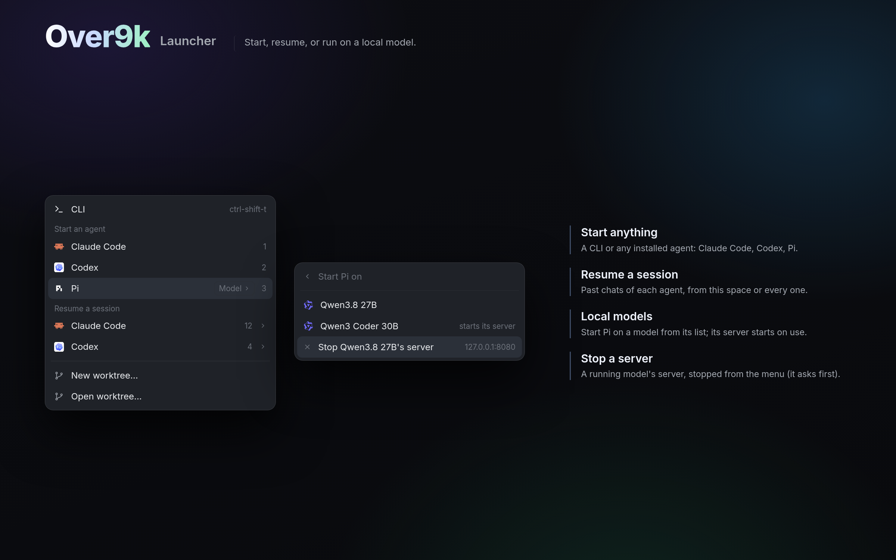

# Over9k Launcher

A menu on Ctrl+Shift+A for starting work. From it you can:

- start a CLI or any installed agent in the space you're in
- resume a past session of Claude Code, Codex or Pi
- start Pi on a local model (its server starts on use)
- stop a running model server
- open or make a git worktree

## What you see

A menu, 340 × 640, on `popover`, with 31px rows (a 14px icon, the name, and a
hint on the right in `dim`):

- **CLI**, with its shortcut.
- **"Start an agent"**: one row per installed agent (Herdr's `knownAgents`),
  numbered 1–9. Agents that aren't installed are hidden. Pi, when its model
  list has local models, gets an outlined "Model ›" button.
- **"Resume a session"**: one row per agent with past sessions, each with its
  count and a chevron.
- **New worktree… / Open worktree…**, in a git repo.
- **The model list:** a back row "‹ Start Pi on", then one row per local model
  in Pi's `~/.pi/agent/models.json`. A model whose server is off says "starts
  its server". Below them, "Stop <model>'s server" for each one running, with
  its address.
- **A session list:** a back row, then the sessions newest first, each with
  its title, project and age. Opened from the computer, every space's newest.

## How it behaves

- **Opening it:** Ctrl+Shift+A opens it for the space you're in.
- **Starting:** a row starts its agent or CLI in a new tab of that space.
  `resume.sh` starts Pi on a model, starting the model's server first when it
  isn't answering. A resumed session opens in its own project's space.
- **Stopping a server:** finds the server's process by `--port N` (`ps`) and
  its stop command in `servers.json`, then opens `over9k-server-stop`, which
  asks before stopping.
- **Shortcuts:** digits 1–9 start that agent. Esc goes back out of a list, or
  closes the menu.

## Built from

- **`mods/over9k-new-menu/`**, with `mod.json` set to `{"place": "none",
  "overlay": {"width": 340, "height": 640}}`:
  - `main.js`: the menu.
  - `resume.sh`: starts or resumes an agent, on a model.
  - `servers.json`: `{"http://127.0.0.1:8081": {"start": "...", "stop": "..."}}`.
  - `qwen.svg`, `stop.svg`.
- **`mods/over9k-server-stop/`**: the confirm dialog. It takes props
  `{name, port, pid, stop, agents}`.
- **`keys.json`:** `global` maps `"ctrl-shift-a"` to `"mod.open:over9k-new-menu"`.
- **herdr:**
  - Reading: `knownAgents`, `spaces`, `panes`, `keys`, `readTextFile`.
  - `run` with `tab.new` and `space.new`.
  - `exec`: `sh`, `curl` (is a server up), `ps`, `git`.
  - `openOverlay` for `over9k-server-stop` and Herdr's `worktree`.
- **Session lists** are read from each agent's own store: Claude Code's
  `~/.claude/projects`, Codex's `~/.codex/sessions`, Pi's sessions.

## Watch out

- Local models need Pi's `models.json` with a provider whose `baseUrl` is
  `127.0.0.1` or `localhost`.
- Starting a server needs its command in `servers.json`.
- Stopping needs the process's command line to carry `--port N`, or a stop
  command.
- Resuming on another computer uses the agent's own model there.
- `curl` waits at most 1s per server.

## Done when

- Ctrl+Shift+A opens the menu listing installed agents. Clicking Claude Code
  opens a tab running it in the current space.
- "Resume a session › Claude Code" lists past sessions. Picking one opens it
  in its project's space.
- With a local model running, "Stop <model>'s server" opens the confirm
  dialog, and confirming stops it.
