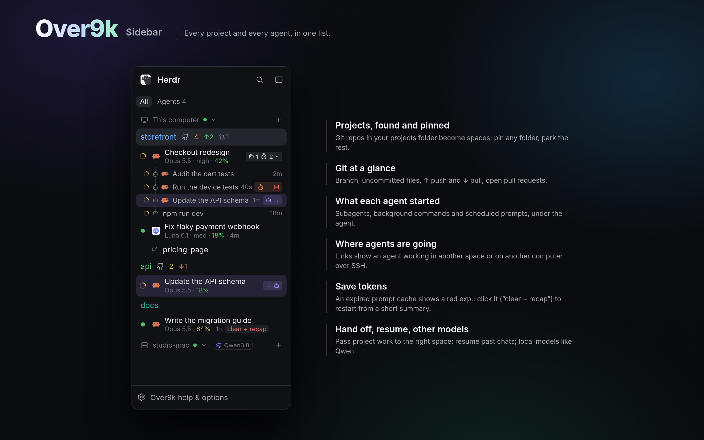

# Over9k Sidebar

Every project and every agent, in one list. Each project shows its git state at
a glance. Under it, each agent shows what it's doing, its model and how full its
context is, plus the subagents, background commands and scheduled prompts it
started. Links show where agents are going: into another space, or over SSH to
another computer. An expired cache becomes a one-click, token-saving recap, and
project work hands off to the right space.

## What you see

It docks on the left, 268px wide (44 when collapsed), on `chrome`, in 13px type.
All colours are theme names.

- **Filter row**, 30px: **All** and **Agents N** as 20px tabs, the picked one on
  `raised`. Agents groups every agent by Space or by Status ("Needs you",
  "Working", "Done").
- **Computer headers**: "This computer" or a machine's name, with a monitor or
  server icon, a connection dot (green, or `dim` when offline, which fades its
  rows), a fold chevron and a +. A local model server that's running shows as a
  chip, such as "Qwen3.8".
- **Project rows**, 30px, 8px radius, the name in the project's colour. The open
  space is on `selected`. After the name:
  - the GitHub mark
  - uncommitted files (`ansi3`)
  - ↑ ahead (`ansi2`) and ↓ behind (`ansi1`)
  - open pull requests (red when your review is wanted)

  Worktrees sit under their checkout with a branch icon.
- **Agent rows**, 26px (compact) or 36px (expanded):
  - Status: a 12px `working` spinner, or a 7px dot in `blocked` or `done`.
    Idle has no mark and a `muted` name.
  - The program's logo and the conversation's name.
  - Details in 11px `dim`: model · effort · context % (green, yellow from 50,
    red from 80) · time since the last reply.
  - When the prompt cache has run out: a red "exp.", then "clear + recap" on
    `hover`, in red.
  - On the right, a count chip (bot n, subagent n, chevron).
- **What an agent started**, on a 1.5px rail under it, 22px rows:
  - subagents (subagent icon)
  - agents in terminals of their own (bot icon)
  - background commands (cpu icon)
  - scheduled prompts (clock icon)

  Each has its name in `muted` and its age.
- **Links**: 16px chips on a 15% tint of a per-link colour. "icon →" sits where
  the work started, "→ icon" where it's happening. Over SSH, the computer's
  server icon follows the arrow. Hovering either end lights up both rows.
- **Not open**: projects with no open space, under a folded heading.
- **Over9k help & options**, a 32px row at the bottom, when there's no Over9k
  footer.

## How it behaves

- **Projects** are git repos in the projects folder (Options › Folders), plus
  folders with a CLAUDE.md, AGENTS.md or .claude, plus pinned ones. "Add new
  projects automatically" pins new ones it finds.
- **Clicks:**
  - Click a project or agent to focus it. Double-click to rename. Drag to
    reorder.
  - Ctrl or Cmd-click picks one more row, and Shift-click a range. Right-click
    a picked row to group them into one tab, close them or unpin them.
  - Right-click a row for its menu (`over9k-menu`): rename, Open folder,
    pin/unpin, Hand off…, splits, zoom, close. Closing asks first, through
    `over9k-close`.
- **Git badges:**
  - The GitHub mark opens the repo.
  - The uncommitted count opens Changes.
  - ↑ pushes (click twice). ↓ pulls (`--ff-only`).
  - Every 5 minutes it runs `git fetch`, and `gh` counts pull requests.
- **What an agent started:** click its chip to show or hide the list. Click a
  subagent to view it, Alt-click to view it in the side panel, × to stop it.
- **clear + recap** sends `/clear` with a recap brief, so the agent restarts
  from a short summary instead of re-reading the whole chat.
- **Hand off…** opens `over9k-handoff`. It asks the agent to pass its project
  work to a new agent in that project's space, with a brief.
- **The + on a computer** opens the launcher (`over9k-new-menu`): start an agent
  or CLI, resume a session, start Pi on a local model, stop a server, add
  spaces.
- **Ctrl+Tab** opens `over9k-switcher`, most recent first. This sidebar keeps
  the order.
- **Options** (the bottom row) covers:
  - folders
  - what each row shows
  - Claude Code's status line, which supplies model, effort, context and cache
  - the hand-off and to-do rules for agents

  Its Help is illustrated, page by page.

## Built from

- **`mods/over9k/`**, with `mod.json` set to `{"place": "left", "size": 268}`:
  - `main.js`: the sidebar.
  - `agent-name.js`, `close-plan.js`.
  - `statusline.sh`: Claude Code's status line. It writes
    `~/.cache/claude-agents/<terminal>.json`, which the sidebar reads.
  - `handoff.sh`, copied to `~/.local/share/over9k` for agents to run.
  - The helper scripts `subagents.sh`, `tasks.sh`, `codex.sh`,
    `subagent-view.sh`, `output-view.sh`, `note-view.sh`, `agy-subagents.py`.
  - `antigravity/` (optional) and the icons.
- **The overlays it opens:** `over9k-menu`, `over9k-new-menu` (with
  `over9k-server-stop`), `over9k-close`, `over9k-rename`, `over9k-handoff`,
  `over9k-panel`, `over9k-switcher`, and `over9k-options` (with `setup.sh`,
  which turns the Claude Code pieces on and off).
- **`keys.json`:** Ctrl+Tab → `over9k.switcher`, Ctrl+Shift+W → `over9k.close-tab`,
  Ctrl+Shift+X → `over9k.close-pane`, plus the switcher's own keys.
- **herdr:**
  - Reading: `spaces`, `agents`, `terminals`, `panes`, `machines`, `focused`,
    `layout`.
  - `run`: `space.select`, `tab.select`, `pane.focus`, `agent.focus`, `tab.new`,
    `space.new`, `layout.set` / `select` / `show` / `hide`, `terminal.peek`.
  - `exec` (`sh`, `git`, `gh`, `ps`, Python), `hc` (`read`, `send`, `kill`,
    `run`), `watchFolder`, `readTextFile`, `openOverlay`, `notify`,
    `nextCommand`.
  - It writes `shared` keys for the others: `projects.pinned`,
    `projects.listed`, `over9k.recentAgents`, `sidebar.options`.

## Watch out

- **Status line:** model, effort, context and cache come from Over9k's status
  line (Options › Claude Code). Without it, agent rows show only the name and
  status.
- **Linux-only extras:** Codex session detection, Antigravity subagents and the
  "SSH'd from here" links read `/proc`.
- **Windows:** needs Git for Windows' `sh`.
- **Side panel:** "View in the side panel" uses the layout's `panel-body` stack.
  A layout without one gets a peek instead.
- **Load:** keep polling gentle, since the sidebar runs git for every visible
  repo. It refreshes git only when something could have changed (a command or
  turn ended, a folder changed), with a fallback timer.

## Done when

- The sidebar docks on the left. With the projects folder set, its git repos
  are listed with branch badges.
- A Claude Code agent in a project shows under it, with a spinner while it
  works. With the status line on, it shows the model and context %.
- A subagent it starts appears under it, and its chip counts it.
- Right-click › Open folder opens the project in the file manager.
- Ctrl+Tab lists agents. Letting go of Ctrl switches.
- After an hour idle, a Claude Code agent shows "exp.". "clear + recap" restarts
  it with a short context.
