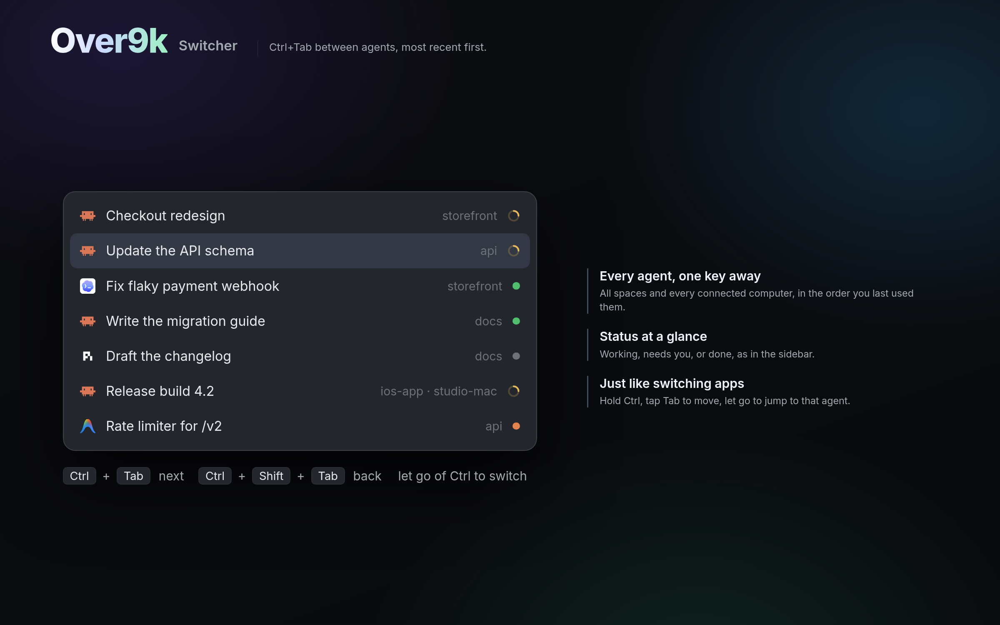

# Over9k Switcher

Jump between agents the way you switch apps. Ctrl+Tab lists every agent on every
space and computer, most recent first, with its status. Hold Ctrl, tap Tab, let
go, and you're there.

## What you see

- **A dialog**, 460 × 420, on `popover`, 6px padding, 1px gaps.
- **One row per agent**, 34px, 10px side padding, 13px text:
  - the program's 15px logo
  - the conversation's name, cut to one line
  - its space in 11.5px `dim` (with " · machine" when it's on another computer)
  - a 12px `working` spinner, or a 7px status dot (`blocked`, `done` or `idle`)
- The picked row is on `selected`. It opens on the second row: the agent you
  were in before this one.

## How it behaves

- **Keys:**
  - Ctrl+Tab opens it. While it's open, Ctrl+Tab moves down and Ctrl+Shift+Tab
    moves up.
  - Letting go of Ctrl (or Cmd) switches to the picked agent.
  - Enter or a click also switches, and Esc closes it.
  - Tab and Shift+Tab without Ctrl, or ↑/↓, also move.
- **Switching** selects the agent's space if it isn't shown, then runs
  `agent.focus`.
- **The order:** most recently used first.
  - Next to Over9k's sidebar, the sidebar keeps it (`over9k.recentAgents`).
  - On its own, the switcher keeps its own (`over9k-switcher.recent`): the agent
    you were in when it opened, and each one it switched to.
  - Agents never used come after, in Herdr's order.
- **Names:** a renamed tab's name, else the conversation's title (Claude
  Code's terminal title, Codex's thread title), else the program.

## Built from

- **`mods/over9k-switcher/`**, with `mod.json` set to `{"place": "none",
  "focusable": true, "overlay": {"width": 460, "height": 420}}`:
  - `main.js`: the dialog.
  - `agent-name.js`: names from terminal titles.
- **`keys.json`:** `global` maps `"ctrl-tab"` to `"mod.open:over9k-switcher"`,
  and `mod:over9k-switcher` maps `"ctrl-tab"` to `"over9k-switcher.next"` and
  `"ctrl-shift-tab"` to `"over9k-switcher.prev"`.
- **herdr:** `agents`, `spaces`, `panes`, `run` (`space.select`,
  `agent.focus`), `nextCommand` (next, prev, focus), `closeOverlay`, `shared` /
  `setShared`, and `on_modifiers_changed` from gpui.

## Watch out

- Ctrl+Tab on every OS, macOS too: there, Cmd+Tab belongs to macOS's own app
  switcher and never reaches Herdr.
- It takes Ctrl+Tab from Herdr's tab switching. Pick another key in
  `keys.json` if you'd rather keep that.
- A remapper sending Cmd+Tab as Ctrl+Tab works, since letting go of Cmd also
  switches.
- On its own, the order only learns from switches made here, not from clicks
  elsewhere.

## Done when

- With three agents, Ctrl+Tab opens the list with the second one picked.
  Letting go of Ctrl focuses it.
- Ctrl+Tab twice in a row goes back to where you started.
- Each row's dot or spinner matches the agent's status.
