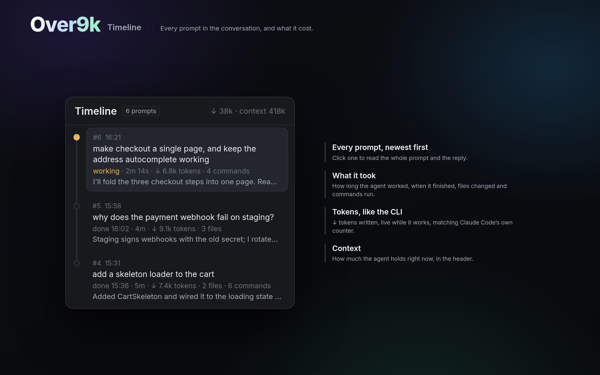

# Over9k Timeline

See what every prompt took. The Timeline lists the conversation you're in, newest
first: how long the agent worked on each prompt, when it finished, the tokens it
wrote, the files it changed and the commands it ran. While it works, the time and
tokens tick live and match the CLI exactly, and the header shows how full its
context is.

## What you see

The panel docks on the right, 368px wide, on `background` with a 1px `border` and
a 10px radius.

- **Header**, 42px, with a 1px `border` below: "Timeline" in semibold, an "N
  prompts" badge, then on the right in 12px `dim` the agent's name and "↓ 38k ·
  context 418k".
- **A line down the left**, 2px, `border` coloured. Each prompt has a 10px dot
  on it: filled `working` for the turn in progress, outlined otherwise.
- **A card per prompt**, with an 8px radius:
  - "#6 16:21" in 10.5px `dim`.
  - The prompt on one line, 12.5px.
  - Messages you sent while the agent was working, as "+ 2 more messages: …".
  - "done 16:02 · 4m · ↓ 9.1k tokens · 3 files · 6 commands" in 11px `dim`,
    or "working" in `working` while the agent works.
  - The reply's first sentence in `muted`.
  - The newest card is on `raised` with an `accent` border.

## How it behaves

- **The agent it follows:** the one you're in, else the last one you were in.
  It re-reads the conversation every 2s, but only once the file has grown.
- **Opening a card:** click one, or use ↑/↓ and Enter. It shows the whole
  prompt, those mid-turn messages with their times, the reply rendered as
  Markdown with selectable text, and the files it changed. Esc closes it.
- **While the agent works:** the time and ↓ tokens are read from the CLI's
  spinner line ("(2m 14s · ↓ 6.8k tokens)") with `hc read`, so they match it.
  Finished turns use the conversation file.
- **Context:** the last reply's input tokens, cached and not, the same figure
  as the status line's context.

## Built from

- **`mods/over9k-prompts/`**, with `mod.json` set to
  `{"place": "right", "size": 368}`:
  - `main.js`: the panel.
  - `prompts.py`: the reader.
  - `timeline.svg`.
- **`prompts.py <file|folder> [last]`** prints `{prompts, context, size, path}`,
  oldest first:
  - **prompts:** `at`, `done`, `text`, `also`, `reply`, `edits`, `cmds`,
    `tools`, `tokens`.
  - **A folder** means its newest `.jsonl`.
  - **last** ("path\tsize"): when that's unchanged, it prints `{"same": true}`.
  - **tokens:** each message's `output_tokens`, counted once (the largest).
  - **Turns:** a queued mid-turn message stays in its turn.
- **Finding the conversation:** Over9k's status line file
  `~/.cache/claude-agents/<terminal>.json` (`transcript`) if there is one.
  Otherwise Claude Code's folder for the agent's working directory,
  `~/.claude/projects/<cwd with non-alphanumerics as ->`.
- **herdr:** `focused`, `agents`, `panes`, `readTextFile`, `exec` (Python), `hc
  read`, `theme`, and `TextView.markdown` from gpui-base.

## Watch out

- Claude Code agents only.
- Without Over9k's status line, two conversations in the same folder resolve
  to the newer one.
- Python is found as `python3`, else `python`.
- Don't use `stat` to check whether the file grew: its flags differ between
  Linux and macOS. The reader checks the size itself.

## Done when

- With a Claude Code agent focused, the panel lists its prompts newest first,
  and the count matches the prompts you sent.
- While it works, the newest card's time and ↓ tokens equal the CLI's spinner
  line, within one refresh.
- The header's context matches the status line's (k-rounded).
- Clicking a card shows the reply rendered as Markdown.
