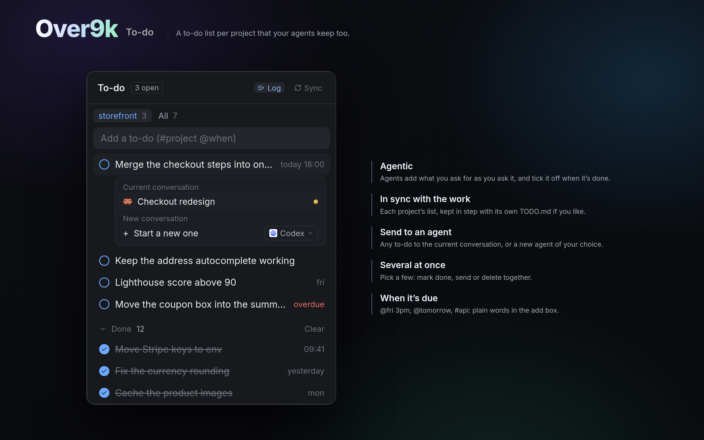

# Over9k To-do

Agentic to-do lists, one per project, that your agents keep for you. Ask for
something and it's on the list; when the agent finishes, it's ticked. Each list
stays in sync with the project's own TODO.md, and any to-do goes to the current
conversation or a new agent in one click, alone or several at once.

## What you see

The panel docks on the right, 368px wide, on `background` with a 1px `border` and
a 10px radius. Colours are theme names.

- **Header**, 42px, with a 1px `border` below:
  - "To-do" in semibold, then an outlined "N open" badge (10px, `muted`).
  - **Log** and **Sync** tags for the project you're in. Each is 10.5px with a
    10px icon (`log.svg`, `sync.svg`): on `raised` with `accent` text when on,
    plain `dim` when off.
- **Tabs**, 20px, 11.5px, the picked one on `raised`: the project you're in
  (its name in its colour, with its open count), then **All**.
- **Add box**, 30px high with an 8px radius on `raised`, reading "Add a to-do
  (#project @when)". Typing `#` or `@` lists matches under it.
- **"Let agents keep these lists · Set up"**, a hint on an accent tint. It shows
  only while the to-do rule isn't in `~/.claude/CLAUDE.md`.
- **Rows**, 30px each:
  - A 14px circle in the project's colour, filled with a tick when done.
  - The text on one line, 13px, struck through and `dim` when done.
  - On the right, in 11px: the due time (`ansi1` when overdue) or the done
    time, and in All the project's name in its colour, flush right.
  - On hover: the full text, a bot button and a ×.
- **Done**: a foldable section (chevron, "Done", count, and Clear on the right),
  then the latest five done to-dos and "Show 10 more".
- **From TODO.md**: lines in the project's TODO.md that aren't on the list, each
  with a + to add it and a × that deletes it from the file.

## How it behaves

- Lists live in `~/.local/share/over9k/todos/<slug>.md`, one per project, where
  the slug is the folder with non-alphanumerics turned into `-`. The panel
  watches that folder, so the `todo` command's changes show at once.
- **Ticking:**
  - Click a circle to tick or untick.
  - Double-click the text to edit it, with `@when` kept.
- **The bot button** opens a card under the row. Under **Current
  conversation**, it lists up to four agents running in that project, by name,
  with their status dot. Under **New conversation**, "Start a new one" starts
  the agent shown in the picker in that project's space, with a brief telling
  it to tick the to-do when done.
- **Picking several** (the project tab only): Ctrl or Cmd-click picks one,
  Shift-click a range. A bar shows "N selected" and Cancel, above Mark done,
  Send to agent and Delete (click twice).
- **Log and Sync** are saved per project, in the list file as
  `<!-- log|sync: on|off -->`.
  - **Log:** agents add what you ask for.
  - **Sync:** add, edit, rm and tick change the project's TODO.md too.
  - A project that hasn't set either follows the defaults in
    `~/.local/share/over9k/todo-defaults`.
- **Set up** runs `setup.sh todo on`. That writes the rule into CLAUDE.md and
  AGENTS.md, puts a `todo` wrapper in `~/.local/bin`, and adds a
  UserPromptSubmit hook that reminds agents while Log is on.
- **The All tab** covers every project's list. Next to Over9k's sidebar, it
  covers that sidebar's pinned projects (`shared("projects.pinned")`) plus the
  one you're in.

## Built from

- **`mods/over9k-todos/`**, with `mod.json` set to `{"place": "right", "size": 368}`:
  - `main.js`: the panel.
  - `agent-name.js`: the agent names the sidebar uses.
  - `todo.sh`: the `todo` command.
  - `todo-cross.py`: the TODO.md edits.
  - `todo-hook.sh`: the hook.
  - `setup.sh`: the agents' setup.
  - `bot.svg`, `log.svg`, `sync.svg`.
- **herdr:**
  - Reading: `focused`, `spaces`, `panes`, `agents`, `knownAgents`.
  - Files: `watchFolder`, `readTextFile`, `writeTextFile`.
  - `exec` runs `sh` and Python, and `git` to find the project's main checkout.
  - `hc send` types a to-do into a running agent.
  - `run` with `tab.new` and `space.new` starts a new one.
  - Also `notify` and `shared` / `setShared`.
- **Programs:** `sh` and `git`; Python 3 for TODO.md edits; `jq` for the hook.

## Watch out

- Python is found as `python3`, else `python` (Windows).
- On Windows, the scripts need Git for Windows' `sh`.
- The project is the git repo's main checkout, so worktrees share one list.
- Agents learn the `todo` command from the rule. `~/.local/bin` must be on PATH.
- TODO.md suggestions are re-read after the list changes, so an agent's edit
  doesn't flash up as a suggestion.

## Done when

- The panel docks on the right and shows the project you're in.
- `todo add "x"` in that project shows "x" within a second.
- Ticking "x" in the panel shows it done in `todo`.
- The bot button on "x" lists a running agent there. Clicking it types the
  to-do into that agent.
- With Sync on, adding a to-do adds it to the project's TODO.md.
- With the rule missing, the hint shows. "Set up" makes `todo` work in a new
  agent's shell and hides the hint.
