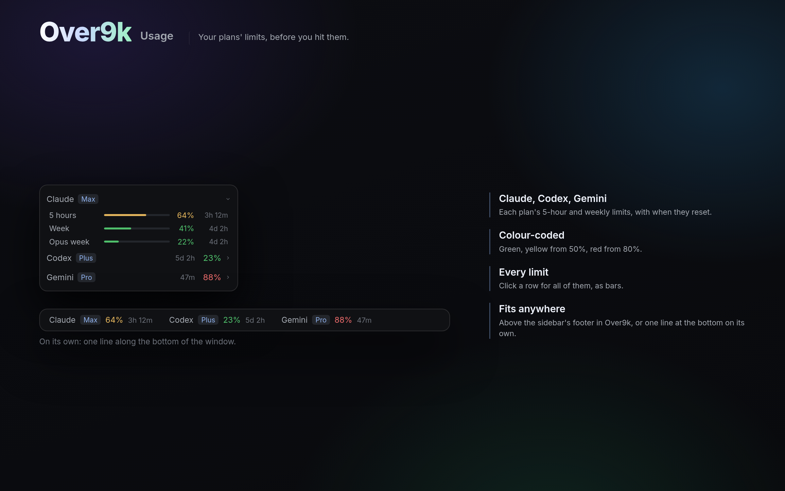

# Over9k Usage

Know your limits before you hit them. Claude's, Codex's and Gemini's 5-hour and
weekly limits sit in one line along the bottom of the window, each coloured green,
yellow or red, with when it resets. Hover a service to see every limit.

## What you see

- **The strip**, docked at the bottom, 30px high, on `chrome` with a 1px
  `border` above, in 12px. For each service:
  - its name in `muted`
  - its plan in a 10.5px badge (`raised`, `accent` text)
  - the most-used limit's percentage: `ansi2` (green) under 50, `ansi3` (yellow)
    from 50, `ansi1` (red) from 80
  - the time until it resets, in 11px `dim`
- **Claude on Amazon Bedrock** has no plan limits (it's paid per use), so its
  row shows a "Bedrock" badge and today's spend, such as "today $14.20". Hover
  or open it for each session's cost by project. This is Claude Code's own
  estimate, not the AWS bill.
- **Inside the Over9k layout**, the same data is drawn as 28px rows above the
  sidebar's footer. Clicking a row opens every limit as a 3px bar.

## How it behaves

- **Hover:** a service shows every limit and its reset time.
- **"Claude · Show its limits"**, a link in `accent` at the end of the strip,
  shows when Claude Code is installed, Over9k's status line isn't on and
  there's no Claude row. It runs `setup.sh status on <this mod>/claude-statusline.sh`.
  That puts a line under Claude Code's prompt (model, effort, context, cache,
  limits) and saves the limits. Any other status line is kept in
  `~/.claude/.over9k-statusline-was.json` and comes back with
  `setup.sh status off`.
- **Where the data comes from:**
  - **Claude:** `~/.cache/over9k/usage/claude.json`, `{at, five_hour,
    seven_day}`, plus the plan name from `~/.claude.json`. Claude Code only
    hands its limits to a status line, so this file comes from Over9k's
    optional one, `claude-statusline.sh`. On Bedrock it holds
    `{at, "bedrock": true}`, and each session's cost per day is in
    `usage/bedrock/<session>.json` as `{days: {"2026-11-04": 2.5}, project}`,
    from the input's `cost.total_cost_usd`.
  - **Codex:** its latest session file under `~/.codex/sessions`.
  - **Gemini:** `~/.cache/over9k/usage/antigravity.json`, from Antigravity's
    status line (`agy-statusline.sh` in the Over9k layout, set up by hand).

## Built from

- **`mods/over9k-usage/`**, with `mod.json` set to
  `{"place": "bottom", "size": 30}`:
  - `main.js`: the strip, or the layout's rows.
  - `claude-statusline.sh`: the optional status line.
  - `setup.sh`: turns it on or off.
- `main.js` draws rows when the layout has a block with id `usage` holding this
  mod (the Over9k layout), and the strip otherwise. Only the rows resize their
  block (`layout.resize`).
- **herdr:** `layout`, `run`, `exec` (`sh`, `jq`), `readTextFile`, `notify`,
  `shared` (`sidebar.options` hides services in Over9k).
- **Programs:** `sh` and `jq`.

## Watch out

- The strip has no room to open rows, so it lists limits on hover instead.
- Without `usage/claude.json` there's no Claude row. Turn the status line on
  only when the user asks: it replaces theirs while on.

## Done when

- The strip docks at the bottom and shows Codex's limits after a Codex
  session.
- With `usage/claude.json` present, Claude shows with its plan and percentage.
- `~/.claude/settings.json` is untouched.
